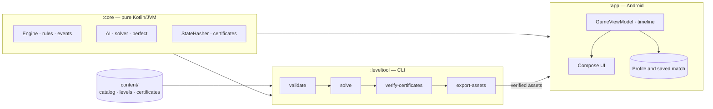

<div align="center">

# NeonLine

**An offline four-in-a-row game for Android. Follow a neon-lit road through 600 levels in three difficulties, each one with a certified solution.**

English · [Português](README.pt.md)

[](https://github.com/SyscallBrain/neon-line/actions/workflows/ci.yml)
[](LICENSE)


<br>


<br>


<sub>Screenshots taken with the app in Portuguese.</sub>

</div>

---

## About

NeonLine is a four-in-a-row game with a campaign. The road has twelve stops, from the 24-Hour Gas to the Boulevard of Lights, and each stop ends with a best-of-three boss against its rival. Along the way, levels mix duels, puzzles ("win in N moves"), defence challenges, shape goals and rule variants: Pop Out, rotating gravity, a move clock, fading neon, bombs, wildcards, locks and five in a row on 9×7 boards.

Every level comes in Easy, Medium and Hard, and all **1,800 variants ship with a solution certificate** (1,872 including boss rounds). An offline solver plays each variant with the same Kotlin engine that runs the game, and the build replays every certificate: if a level can no longer be won the way its certificate says, the build fails.

Rivals are deterministic. The same level with the same moves always gets the same answers, so losing never comes down to luck.

## Features

- **Campaign:** 600 levels in three independent difficulties, guided tutorials, stars, a progress map and 48 achievements.
- **Daily challenge:** one certified puzzle per day and difficulty, with 270 days of history.
- **Puzzle rush:** 500 certified positions against the clock, with a best score per difficulty.
- **Tournament:** eight rounds against bosses you have already beaten.
- **Free play:** an empty board against the rivals you have met, with your choice of rules, or against Perfect Mode.
- **Two-player duel:** two people on one phone, with saved sessions, names, scores and a table layout where player 2 faces the other way.
- **Learning tools:** hints, undo, a tactical review of each result and, on Easy, a marker on the rival's immediate threats.
- **Accessibility:** TalkBack support for columns and moves, colour modes for deuteranopia, protanopia and tritanopia, symbols on pieces, reduced motion and larger text.
- **Four board themes**, unlocked with campaign stars.
- **Portrait and landscape** layouts.
- **English and Portuguese.** The app follows the system language. On Android 13 and later you can also choose it in the app's Settings.

## Download

Signed APKs are published on the [Releases](https://github.com/SyscallBrain/neon-line/releases) page. Each release lists the SHA-256 of the APK and of its signing certificate, so you can check the download:

```bash
sha256sum NeonLine-*.apk
apksigner verify --print-certs NeonLine-*.apk   # compare "certificate SHA-256 digest"
```

NeonLine needs Android 8.0 (API 26) or later. Every release is signed with the same key, so new versions install over old ones and keep your progress.

## Privacy

NeonLine declares a single permission, `VIBRATE`. It has no internet access, collects no data and contains no third-party SDKs, ads or analytics. Progress is stored in the app's private storage and excluded from cloud backups. You can export and import it manually from Settings through the Android document picker.

## Building from source

### Requirements

| Tool | Version |
|---|---|
| JDK | 17 or newer (the project is built with JDK 21) |
| Android SDK | Platform `android-37.1`, build tools 37 |
| Gradle | Wrapper included (9.8.0) |

No emulator is needed: the game logic is tested on the JVM.

### Build and install

```bash
export JAVA_HOME=/path/to/jdk-21          # any JDK 17+
export ANDROID_HOME=/path/to/android-sdk  # or create local.properties with sdk.dir=...

./gradlew :app:assembleDebug
adb install app/build/outputs/apk/debug/app-debug.apk
```

| Build type | Purpose |
|---|---|
| `debug` | Development; debuggable and slower. |
| `benchmark` | Release configuration (R8, not debuggable) signed with the debug key, to check release speed and behaviour on a device. |
| `release` | The published APK. Unsigned unless the signing properties below are set. |

### Signing a release

Define the signing properties in your own `~/.gradle/gradle.properties`, never in the repository:

```properties
neonLine.release.storeFile=/absolute/path/to/neonline-release.jks
neonLine.release.storePassword=...
neonLine.release.keyAlias=neonline
neonLine.release.keyPassword=...
```

Then run `bash tools/release.sh`. It builds the signed APK, verifies the signature and writes the APK with its SHA-256 and certificate fingerprint to `build/release/`, ready to attach to a GitHub release. It does not publish anything.

### Full verification

```bash
bash tools/verify.sh
```

This runs the unit tests of all three modules, Android lint and the debug APK build, validates the published catalog and replays its certificates. It reports the real exit code of each step and writes the logs to `logs/`.

## Architecture



| Module | Role |
|---|---|
| [`core/`](core) | Deterministic rules engine with no Android dependencies: drops and pops, gravity with blocked cells, line detection (4 and 5), the rule variants, game events, the AI, the solver and the state hasher used by certificates. |
| [`leveltool/`](leveltool) | Content CLI that uses the same engine to generate levels from families, solve and certify them, balance them and export the packaged assets. |
| [`app/`](app) | Jetpack Compose UI, the game view model, the animation timeline, input, sound and haptics. |
| [`content/`](content) | The level catalog: 600 published level files and 1,872 certificates. |
| [`tools/`](tools) | Verification, release and sound-generation scripts. |

Some design choices:

- **One engine everywhere.** The game, the AI, the solver and the certificate checker all run the same `:core` code, so a certified solution is replayed exactly as a player would play it.
- **Pure turns.** A move is resolved by one pure function that returns events; the UI only animates them. Frame rate never changes the result, and the move clock lives in the app, not in the engine.
- **Node-bounded search.** The AI and the solver are limited by nodes, never by time, so the same position always gets the same answer on the JVM and on the phone.
- **Verified content.** Every packaged level is checked against a manifest of SHA-256 hashes. The first launch after an install verifies the whole catalog in parallel and keeps a private index, so later launches skip that work.
- **Crash-safe progress.** Matches are saved after each move on a background thread and restored by replay with hash checks, including the random streams, hints, undo and the clock. An unreadable profile is kept aside and recovery is attempted.

### Working on content

The level pipeline runs offline through `:leveltool`, for example:

```bash
./gradlew :leveltool:validateCatalog          # strict catalog validation
./gradlew :leveltool:verifyCertificates       # replay every certificate
./gradlew :leveltool:run --args="report --root content --output build/report.md"
```

See [CONTRIBUTING.md](CONTRIBUTING.md) for the rules on changing level content.

## Contributing

Bug reports, translations and pull requests are welcome. Please read [CONTRIBUTING.md](CONTRIBUTING.md) first. It covers the development setup, coding conventions and the rules for changing level content.

## License

[MIT](LICENSE) © 2026 Tiago Correia
