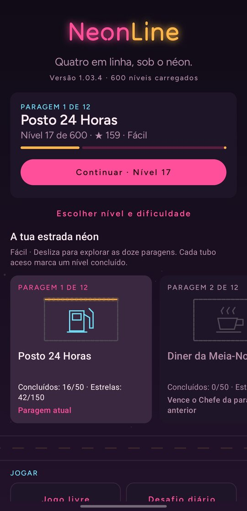
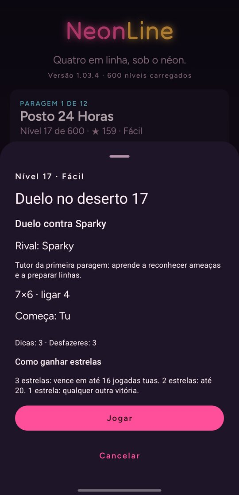
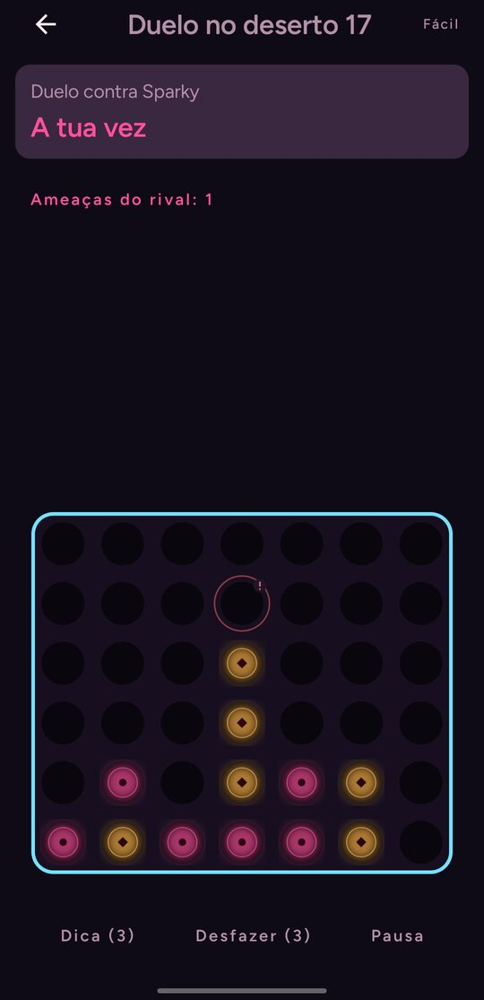
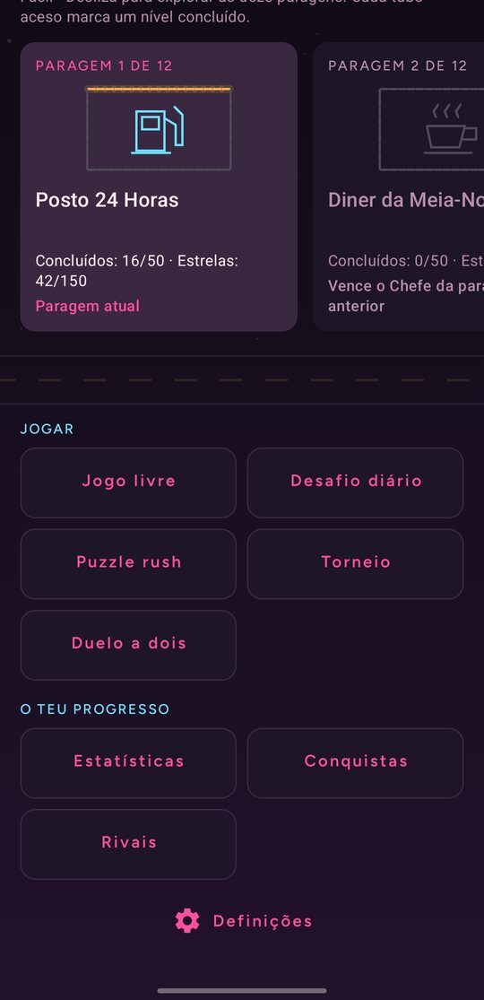
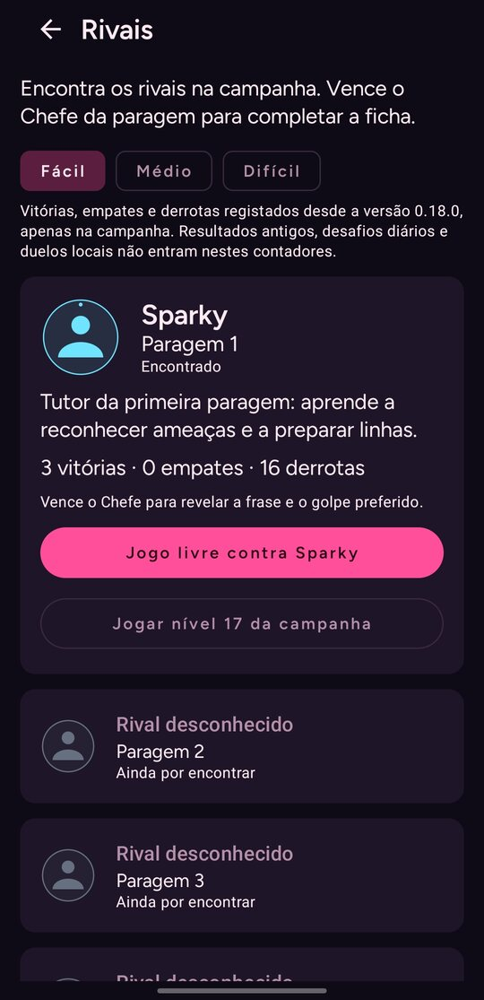
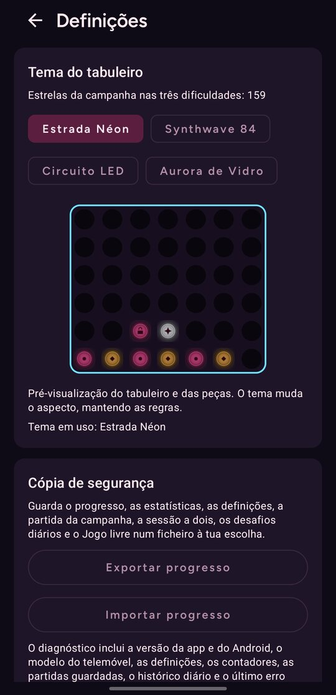
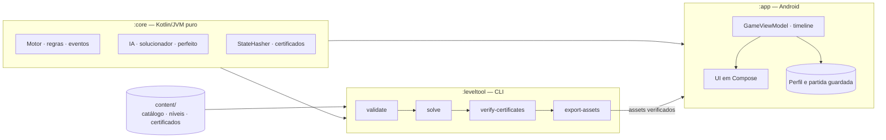

<div align="center">

# NeonLine

**Um jogo de quatro em linha para Android, sem internet. Segue uma estrada de néon por 600 níveis em três dificuldades, cada um com uma solução certificada.**

[English](README.md) · Português

[](https://github.com/SyscallBrain/neon-line/actions/workflows/ci.yml)
[](LICENSE)


<br>





<br>




</div>

---

## Sobre o jogo

O NeonLine é um jogo de quatro em linha com campanha. A estrada tem doze paragens, do Posto 24 Horas à Avenida das Luzes, e cada paragem termina com um chefe à melhor de três contra o seu rival. Pelo caminho, os níveis misturam duelos, puzzles ("ganha em N jogadas"), desafios de defesa, objectivos de forma e variantes de regras: Pop Out, gravidade que roda, relógio por jogada, néon que se apaga, bombas, curingas, cadeados e cinco em linha em tabuleiros 9×7.

Cada nível existe em Fácil, Médio e Difícil, e **as 1800 variantes trazem um certificado de solução** (1872 contando com as rondas dos chefes). Um solucionador offline joga cada variante com o mesmo motor em Kotlin que corre no jogo, e a compilação repete todos os certificados: se um nível deixar de se poder ganhar como o certificado indica, a compilação falha.

Os rivais são determinísticos. O mesmo nível com as mesmas jogadas recebe sempre as mesmas respostas, por isso perder nunca depende da sorte.

## Funcionalidades

- **Campanha:** 600 níveis em três dificuldades independentes, tutoriais guiados, estrelas, mapa de progresso e 48 conquistas.
- **Desafio diário:** um puzzle certificado por dia e por dificuldade, com 270 dias de histórico.
- **Puzzle rush:** 500 posições certificadas contra o relógio, com recorde por dificuldade.
- **Torneio:** oito rondas contra chefes que já venceste.
- **Jogo livre:** tabuleiro vazio contra os rivais que já encontraste, com as regras à tua escolha, ou contra o Modo Perfeito.
- **Duelo a dois:** duas pessoas no mesmo telemóvel, com sessões guardadas, nomes, marcador e um modo mesa em que o jogador 2 fica virado ao contrário.
- **Ajuda para aprender:** dicas, desfazer, revisão táctica de cada resultado e, no Fácil, a marcação das ameaças imediatas do rival.
- **Acessibilidade:** suporte ao TalkBack nas colunas e nas jogadas, modos de cor para deuteranopia, protanopia e tritanopia, símbolos nas peças, movimento reduzido e texto maior.
- **Quatro temas de tabuleiro**, desbloqueados com estrelas da campanha.
- **Layouts em vertical e em horizontal.**
- **Inglês e português.** A app segue a língua do sistema. No Android 13 ou mais recente também a podes escolher nas Definições da app.

## Download

Os APK assinados são publicados na página de [Releases](https://github.com/SyscallBrain/neon-line/releases). Cada release indica o SHA-256 do APK e do certificado de assinatura, para poderes confirmar o ficheiro:

```bash
sha256sum NeonLine-*.apk
apksigner verify --print-certs NeonLine-*.apk   # compara o "certificate SHA-256 digest"
```

O NeonLine precisa do Android 8.0 (API 26) ou mais recente. Todas as versões são assinadas com a mesma chave, por isso cada nova versão instala-se por cima da anterior e mantém o teu progresso.

## Privacidade

O NeonLine declara uma única permissão, `VIBRATE`. Não tem acesso à internet, não recolhe dados e não inclui SDK de terceiros, anúncios nem estatísticas de utilização. O progresso fica no armazenamento privado da app e não entra nas cópias de segurança na nuvem. Podes exportá-lo e importá-lo manualmente nas Definições, através do seletor de documentos do Android.

## Compilar a partir do código

### Requisitos

| Ferramenta | Versão |
|---|---|
| JDK | 17 ou mais recente (o projecto é compilado com o JDK 21) |
| Android SDK | Plataforma `android-37.1`, build tools 37 |
| Gradle | Wrapper incluído (9.8.0) |

Não é preciso emulador: a lógica do jogo é testada na JVM.

### Compilar e instalar

```bash
export JAVA_HOME=/caminho/para/jdk-21          # qualquer JDK 17+
export ANDROID_HOME=/caminho/para/android-sdk  # ou cria local.properties com sdk.dir=...

./gradlew :app:assembleDebug
adb install app/build/outputs/apk/debug/app-debug.apk
```

| Tipo de build | Para que serve |
|---|---|
| `debug` | Desenvolvimento; depurável e mais lento. |
| `benchmark` | Configuração de release (R8, não depurável) assinada com a chave de debug, para confirmar a velocidade e o comportamento do release num telemóvel. |
| `release` | O APK publicado. Sai sem assinatura se as propriedades abaixo não estiverem definidas. |

### Assinar um release

Define as propriedades de assinatura no teu `~/.gradle/gradle.properties`, nunca no repositório:

```properties
neonLine.release.storeFile=/caminho/absoluto/para/neonline-release.jks
neonLine.release.storePassword=...
neonLine.release.keyAlias=neonline
neonLine.release.keyPassword=...
```

Depois corre `bash tools/release.sh`. O script compila o APK assinado, verifica a assinatura e escreve em `build/release/` o APK com o SHA-256 e a impressão digital do certificado, pronto para anexar a um release do GitHub. Não publica nada.

### Verificação completa

```bash
bash tools/verify.sh
```

Corre os testes unitários dos três módulos, o lint do Android e a compilação do APK de debug, valida o catálogo publicado e repete os certificados. Mostra o código de saída real de cada passo e grava os registos em `logs/`.

## Arquitectura



| Módulo | Papel |
|---|---|
| [`core/`](core) | Motor de regras determinístico sem dependências do Android: largar e retirar peças, gravidade com casas bloqueadas, detecção de linhas (4 e 5), variantes de regras, eventos de jogo, a IA, o solucionador e o hasher de estados usado pelos certificados. |
| [`leveltool/`](leveltool) | CLI de conteúdo que usa o mesmo motor para gerar níveis a partir de famílias, resolvê-los e certificá-los, equilibrá-los e exportar os assets empacotados. |
| [`app/`](app) | UI em Jetpack Compose, o view model do jogo, a timeline das animações, input, som e vibração. |
| [`content/`](content) | O catálogo de níveis: 600 ficheiros de nível publicados e 1872 certificados. |
| [`tools/`](tools) | Scripts de verificação, de release e de geração de sons. |

Algumas escolhas de desenho:

- **Um só motor.** O jogo, a IA, o solucionador e o verificador de certificados correm todos o mesmo código do `:core`, por isso uma solução certificada é repetida exactamente como um jogador a jogaria.
- **Turnos puros.** Cada jogada é resolvida por uma função pura que devolve eventos; a UI limita-se a animá-los. A taxa de fotogramas nunca muda o resultado, e o relógio por jogada vive na app, não no motor.
- **Pesquisa limitada por nós.** A IA e o solucionador são limitados por número de nós, nunca por tempo, por isso a mesma posição recebe sempre a mesma resposta na JVM e no telemóvel.
- **Conteúdo verificado.** Cada nível empacotado é conferido contra um manifesto de hashes SHA-256. O primeiro arranque depois de instalar verifica o catálogo inteiro em paralelo e guarda um índice privado, para os arranques seguintes não repetirem esse trabalho.
- **Progresso à prova de falhas.** As partidas são guardadas depois de cada jogada, num thread em segundo plano, e restauradas por repetição com verificação de hashes, incluindo os geradores aleatórios, as dicas, o desfazer e o relógio. Um perfil ilegível é posto de parte e tenta-se a recuperação.

### Trabalhar no conteúdo

O processamento dos níveis corre offline através do `:leveltool`, por exemplo:

```bash
./gradlew :leveltool:validateCatalog          # validação estrita do catálogo
./gradlew :leveltool:verifyCertificates       # repetir todos os certificados
./gradlew :leveltool:run --args="report --root content --output build/report.md"
```

As regras para alterar o conteúdo dos níveis estão no [CONTRIBUTING.md](CONTRIBUTING.md) (em inglês).

## Contribuir

Relatórios de erros, traduções e pull requests são bem-vindos. Lê primeiro o [CONTRIBUTING.md](CONTRIBUTING.md) (em inglês), que explica a preparação do ambiente, as convenções de código e as regras para alterar o conteúdo dos níveis.

## Licença

[MIT](LICENSE) © 2026 Tiago Correia
